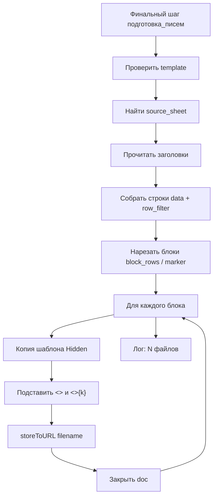

# ТЗ: финальная обработка `подготовка_писем` (AText из ACell)

Версия ТЗ: 1.1  
Связь: финальная фаза сбора (`Финальная_обработка`), статус реализации по [14_TZ_UNIFICATION.md](../docs/14_TZ_UNIFICATION.md) §3.5 B.

## 1. Цель

По данным **листа ACell** (Calc) и **шаблона AText** (Writer, `.odt` / `.ott`) сформировать **ряд файлов-писем** — по одному файлу на **блок строк** данных. Аналог «подготовки писем» / mail-merge без SMTP: только генерация документов на диск.

Брендинг AlterOffice: **ACell** = таблица, **AText** = текст. В LibreOffice — Calc / Writer; реализация через UNO общая.

## 2. Сценарий пользователя

1. В ACell есть таблица с заголовками (ФИО, Адрес, Сумма, …) и строками данных.
2. В AText подготовлен шаблон письма с полями, имена которых совпадают с заголовками столбцов; при блоке из нескольких строк — с индексом строки в блоке.
3. В книге параметров на листе **Финальная_обработка** задаётся шаг `подготовка_писем` (JSON в C).
4. После сбора макрос для каждого блока строк:
   - копирует шаблон;
   - подставляет значения из ячеек блока в поля шаблона;
   - сохраняет файл в каталог вывода под именем из шаблона имени файла.

## 3. Блоки строк

| Параметр | Default | Смысл |
|----------|---------|--------|
| `block_rows` | `1` | Сколько физических строк данных образуют один выходной файл |

- `block_rows = 1` — классический mail-merge: одна строка → один файл; в шаблоне достаточно `<<Столбец>>`.
- `block_rows = N` (N ≥ 2) — данные режутся на сегменты длины N подряд (сверху вниз); хвост &lt; N обрабатывается как укороченный блок (индексы 1…хвост; ссылки на отсутствующие строки → пусто / warning).

Альтернатива (v1, опционально, как у `добавить_объединение`):

| Режим | Поле | Смысл |
|-------|------|--------|
| Константа | `block_rows` | Фиксированная высота |
| Опорный столбец | `marker` | Высота блока = высота вертикального merge в столбце-маркере (взаимно исключ. с `block_rows`, кроме default) |

Если заданы оба явно — ошибка нормализации. Если ничего не задано — `block_rows=1`.

`row_filter`: применяется к **строкам до нарезки блоков**. Строка, не прошедшая фильтр, не входит в блоки (сдвиг нарезки — **не** делать: проще сначала собрать список «живых» строк сверху вниз, затем нарезать их на блоки по N). Зафиксировано: **сначала filter → список строк → нарезка на блоки по `block_rows`**.

## 4. Привязка полей шаблона ↔ столбцы ACell

### 4.1. Синтаксис плейсхолдеров

```text
<<Имя_столбца>>
<<Имя_столбца>>{k}
```

где `k` — **1-based индекс строки внутри текущего блока** (1 = первая строка блока).

| Запись | Значение |
|--------|----------|
| `<<Адрес>>` | то же, что `<<Адрес>>{1}` — первая строка блока |
| `<<Адрес>>{1}` | столбец «Адрес», строка 1 блока |
| `<<Адрес>>{2}` | столбец «Адрес», строка 2 блока |
| `<<'ФИО'>>{2}` | кавычки в имени снимаются; строка 2 блока |

Примеры шаблона при `block_rows=2`:

```text
Основной получатель: <<ФИО>>{1}
Дополнительный: <<ФИО>>{2}

Адрес 1: <<Адрес>>{1}
Адрес 2: <<Адрес>>{2}
```

При `block_rows=1` формы `<<ФИО>>` и `<<ФИО>>{1}` эквивалентны; `{2}` и выше → пусто + warning.

Правила сопоставления с заголовком столбца:

| В шаблоне | На листе |
|-----------|----------|
| `<<ФИО>>` / `<<ФИО>>{1}` | заголовок `ФИО` (после `clean_header_name` / trim) |
| регистр | без учёта регистра (`lm_identity_key`) |

Не найденный столбец / индекс вне блока → по `missing_column` (default `empty`).

### 4.2. Имя файла и пути

Те же плейсхолдеры с индексацией:

- `<<Имя_столбца>>` / `<<Имя_столбца>>{k}` — значение из строки k блока (без индекса = 1);
- `<<n>>` / `{n}` — порядковый номер **файла** (блока) 1…N;
- `<<row>>` / `{row}` — 1-based номер **первой** физ. строки блока на листе;
- `<<row>>{k}` — номер физ. строки k-й строки блока на листе.

Пример: `Письмо_<<ФИО>>{1}_<<ФИО>>{2}_<<n>>` → `Письмо_Иванов_Петров_3.odt`.

Санитизация имени: `\/:*?"<>|` → `_`; обрезка длины.

### 4.3. User Fields (желательно v1)

Имя поля Writer:

- `ФИО` → значение из строки 1 блока;
- `ФИО_2` / `ФИО{2}` — если такой naming удобен; **минимум v1**: User Field `Имя` = `<<Имя>>{1}` только.

Зафиксировано для v1 User Fields: только без индекса (= строка 1 блока). Индексация `{k}` — обязательна для текстовых `<<…>>`; для User Fields расширение later.

Порядок подстановки в документе: **сначала текстовые `<<…>>{k}` / `<<…>>`, затем sync User Fields (строка 1)**.

### 4.4. Вне scope v1

- Поля серийной печати LO (database mail-merge wizard).
- Закладки как единственный способ привязки.
- Условные блоки IF / циклы FOR по строкам блока внутри шаблона (пользователь сам пишет `{1}`…`{N}`).

## 5. Параметры JSON (колонка C, финал)

Имя функции: **`подготовка_писем`**  
Алиасы: `письма_по_шаблону`, `atext_letters`, `mail_merge_files`.

| Поле | Тип | Обяз. | Смысл |
|------|-----|-------|--------|
| `template` | string | да | Путь к шаблону AText (`.odt` / `.ott`). Допустимы `<<Переменные.…>>` в пути |
| `source_sheet` | string | да* | Лист ACell с данными (*или `sheet`) |
| `header_row` | int 1-based | нет | Строка заголовков; default — из контекста / 1 |
| `data_start_row` | int 1-based | нет | Первая строка данных; default = header_row+1 |
| `data_end_row` | int / пусто | нет | Последняя строка; пусто — used area |
| `block_rows` | int ≥ 1 | нет | Высота блока; **default 1** |
| `marker` | token | нет | XOR с явным `block_rows>1`: опорный столбец с merge |
| `columns` | list tokens | нет | Ограничить столбцы подстановки; пусто — все |
| `row_filter` | string lambda | нет | Фильтр строк **до** нарезки блоков |
| `out_dir` | string | да | Каталог вывода |
| `filename` | string | да | Шаблон имени, напр. `Письмо_<<ФИО>>{1}_<<n>>` |
| `format` | combo | нет | `odt` (default) / `pdf` / `docx` |
| `open_folder` | bool | нет | default false |
| `overwrite` | bool | нет | default true |
| `max_files` | int | нет | Лимит файлов (блоков); default 500 |
| `missing_column` | combo | нет | `empty` / `keep` / `fail` |

Примеры:

```json
[{
  "v": 1,
  "fn": "подготовка_писем",
  "template": "/data/templates/уведомление.odt",
  "source_sheet": "Получатели",
  "header_row": 1,
  "data_start_row": 2,
  "block_rows": 1,
  "out_dir": "/data/out/letters",
  "filename": "Письмо_<<ФИО>>_<<n>>",
  "format": "odt"
}]
```

```json
[{
  "v": 1,
  "fn": "подготовка_писем",
  "template": "/data/templates/пара_адресатов.odt",
  "source_sheet": "Получатели",
  "block_rows": 2,
  "out_dir": "/data/out/pairs",
  "filename": "Пара_<<ФИО>>{1}_<<ФИО>>{2}_<<n>>",
  "format": "odt",
  "row_filter": "lambda rows: str(rows(\"ФИО\") or \"\").strip() != \"\""
}]
```

## 6. Алгоритм



На блоке `[row_1 … row_m]` (m ≤ block_rows):

1. Матрица значений: для k=1..m, для каждого заголовка — `cell_text`.
2. Замена в тексте: все `<<Имя>>{k}` и `<<Имя>>` (= `{1}`) по матрице.
3. User Fields без индекса ← строка 1.
4. Имя файла с теми же правилами индексации; сохранить; закрыть.

Цикл блоков сверху вниз. Ошибка на одном блоке — log + продолжить (если не `fail`).

## 7. Визард

- `template`, `source_sheet`, `header_row`, `data_start_row`;
- `block_rows` — edit, default `1`;
- `marker` — `columns_pick` (опц., режим XOR);
- `columns` — `columns_pick`;
- `out_dir`, `filename` — hint: `<<Столбец>>`, `<<Столбец>>{2}`, `<<n>>`;
- `format`, `row_filter`, `max_files`, `overwrite`, `open_folder`.

Hint: при `block_rows>1` в шаблоне AText указывать `<<Заголовок>>{1}`, `<<Заголовок>>{2}`, …; без `{k}` = первая строка блока.

## 8. Регистрация (когда кодировать)

| Что | Куда |
|-----|------|
| Логика | `pythonpath/libre_macros_atext_letters_lib.py` |
| `lm_final_atext_letters` | `libre_macros_final_lib.py` / thin wrapper |
| Карта | `_FINAL_MAP_SPEC`: `подготовка_писем` → `merge_final_atext_letters` |
| Codec | `_normalize_atext_letters_block` + form fn |
| Визард | `_FALLBACK_FINAL_CHOICES` + schema |

```python
def lm_final_atext_letters(doc, sheets, data_ranges, header_row_ranges, *extra_args):
    ...
```

## 9. Критерии приёмки (ручные)

1. `block_rows=1`, шаблон `<<ФИО>>` / `<<Сумма>>`, 3 строки → 3 файла.
2. `block_rows=2`, шаблон `<<ФИО>>{1}` и `<<ФИО>>{2}`, 4 строки → 2 файла; имя `…_<<ФИО>>{1}_<<ФИО>>{2}_<<n>>`.
3. `<<Адрес>>` без индекса при `block_rows=2` = адрес первой строки блока.
4. Хвост из 1 строки при `block_rows=2`: `{2}` → пусто + warning; файл всё же создаётся.
5. `row_filter` отсекает строки до нарезки блоков.
6. Оригинал шаблона не изменён; `format=pdf` при доступном фильтре.
7. Визард / combo финала видят функцию.

## 10. Тестовый набор (после реализации)

- `sources/atext_letters/source_recipients.xlsx`;
- `sources/atext_letters/template_letter.odt` — `block_rows=1`;
- `sources/atext_letters/template_pair.odt` — `<<…>>{1}` / `{2}`;
- `workbooks/20_atext_letters.xltx`.

## 11. Зафиксированные решения

| Вопрос | Решение |
|--------|---------|
| Синтаксис | `<<Имя>>` = `{1}`; `<<Имя>>{k}` — k-я строка блока |
| Размер блока | `block_rows` (default 1); опц. `marker` |
| Один файл на | один блок строк |
| Filter | до нарезки блоков |
| Где шаг | только **Финальная_обработка** |
| Каталог | `makedirs(out_dir)` |

## 12. Не делать в v1

- Отправка SMTP / compose (есть `отправить_по_почте`).
- HTML-шаблоны.
- Автогенерация N строк плейсхолдеров в шаблоне.
- User Fields с индексом `{k}` (только строка 1).
